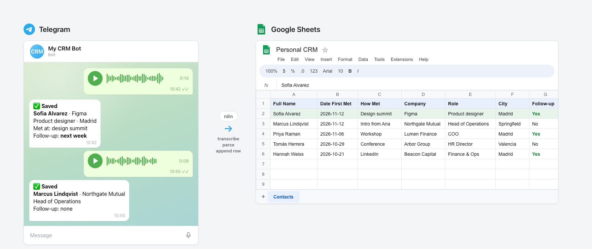
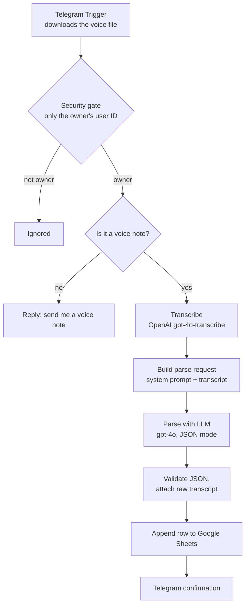

# Personal Voice CRM



<sub>Illustrative mock-up with fictional contacts: the bot confirms each capture in Telegram, and the row appears in the Google Sheet. Telegram and Google Sheets are trademarks of their owners.</sub>

A low-friction personal CRM: you capture a contact by sending a **voice note** to a private Telegram bot, and a self-hosted **n8n** workflow transcribes it, extracts structured fields with an LLM, stores a row in **Google Sheets**, and replies with a confirmation.

**Status:** Slice 1 (voice note → new contact → confirmation) is built as an importable workflow. Updating existing contacts, calendar events, natural-language queries and the daily digest are designed but **not built yet**; see the roadmap in [docs/design-decisions.md](docs/design-decisions.md).

## The idea

Most CRMs die because logging a contact takes longer than the conversation that produced it. The north star here is the opposite: capture should take ten seconds, right after the coffee, with no form. A voice note like

> "Met Sofia Alvarez at the design summit in Madrid, she's a product designer at Figma, into type systems, said she'd introduce me to her design lead. Follow up next week."

becomes a row with name, company, role, where we met, what she does, tags and a follow-up flag, plus a ✅ confirmation in the same chat.

## How it works (Slice 1)



| Step | Choice | Why |
|---|---|---|
| Interface | Private Telegram bot, gated to one user ID | Zero UI to build, voice notes are native, works on any phone |
| Transcription | OpenAI transcription API | Replaced a self-hosted whisper.cpp service: one fewer always-on process to fail silently |
| Parsing | LLM in JSON mode with a fixed schema | 16 columns, header-mapped, so the sheet stays human-editable |
| Dates | Resolved in n8n code, not by the LLM | LLMs are unreliable at calendar math |
| Confirmation | Deterministic template | Faster and cannot hallucinate |
| Store | One Google Sheets tab | Free, inspectable, exportable |

Estimated running cost is a few dollars per month, almost all of it API calls.

## What I would highlight

- **The design was reviewed before it was built.** The first specification had real bugs (inconsistent column keys, a birthday-window edge case across the year boundary, LLM-resolved dates). They are documented in [docs/design-decisions.md](docs/design-decisions.md) together with the decisions that replaced them.
- **Reliability is a feature.** Every capture is confirmed, and an error workflow is on the roadmap before any other feature, so a failed capture is loud, not silent.
- **Thin vertical slice first.** One end-to-end path (new contact only) before update, calendar, query and digest logic.

## Repository layout

```
workflows/slice1-voice-to-contact.json   importable n8n workflow (Slice 1)
schema/contacts-columns.csv              the 16 sheet columns, in order
docs/design-decisions.md                 what changed from the first design, and why
docs/original-specification.md           the original full design (historical)
```

## Run it yourself

You need an n8n instance, a Telegram bot (token from @BotFather) and your numeric Telegram user ID, an OpenAI API key, and a Google Cloud project with the Sheets API enabled.

1. Create a Google Sheet with a tab named `Contacts` and the headers from `schema/contacts-columns.csv` in row 1.
2. In n8n: **Workflows → Import from File** → `workflows/slice1-voice-to-contact.json`.
3. Replace the two placeholders: `OWNER_ID = 123456789` in the **Security Gate** node, and `PASTE_SPREADSHEET_ID` in **Append to Sheets**.
4. Create credentials and attach them: a Telegram credential (trigger and both reply nodes), an *HTTP Header Auth* credential for OpenAI (header `Authorization`, value `Bearer <your key>`), and a Google Sheets OAuth2 credential.
5. Activate the workflow and send the bot a voice note.

Likely first-run friction: the transcribe node expects the downloaded audio in a binary property called `data` (check the Telegram trigger output if it complains), imported nodes may need to be opened and re-saved to match your n8n version, and the Sheets column mapping may need one click to read the headers.

## Privacy

The workflow stores personal data about other people (names, employers, notes). Keep the sheet private, keep the bot gated to your user ID, and tell people you keep notes about them if they ask. No credentials or IDs are included in this repository; the credential references in the workflow JSON are empty.

## Licence

[MIT](LICENSE).

---

<sub>Part of [AI Build Log](https://github.com/96jjrevorio/ai-build-log) · by [Julián Revorio](https://www.linkedin.com/in/julianrevorio/)</sub>
